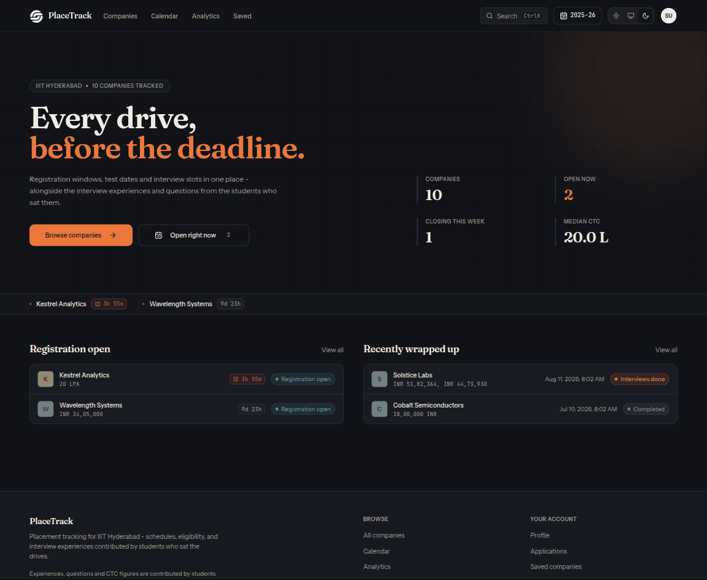
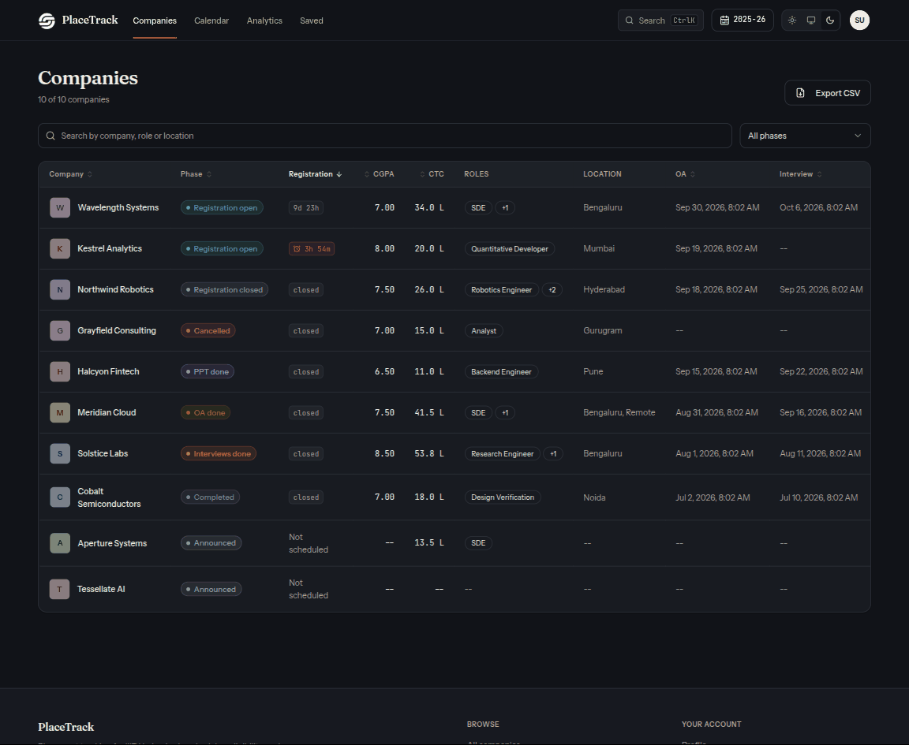
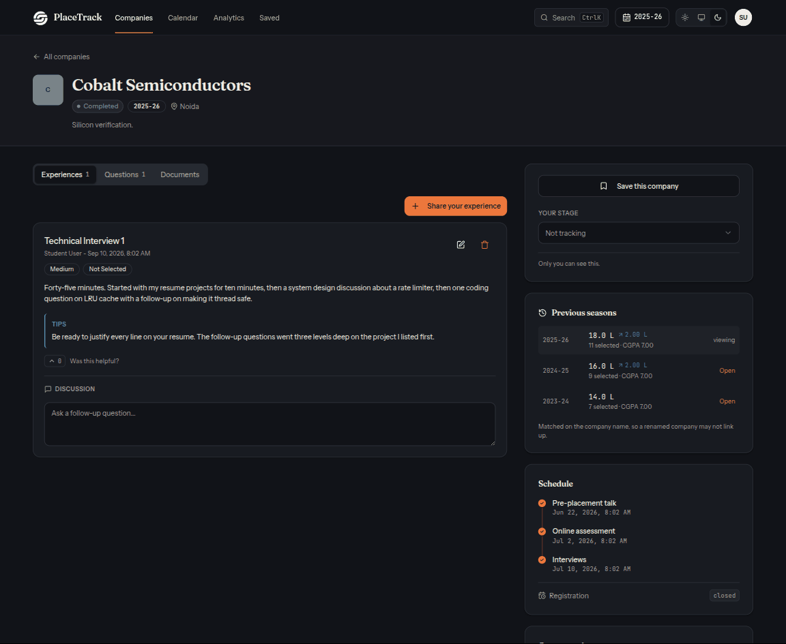
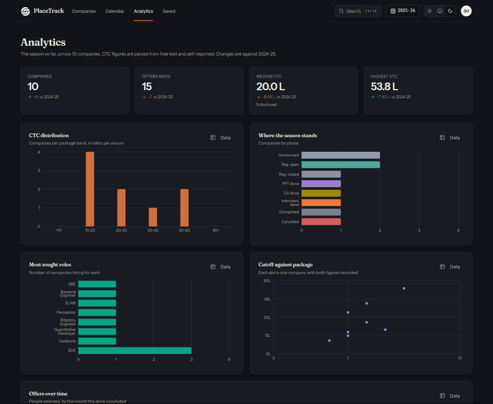
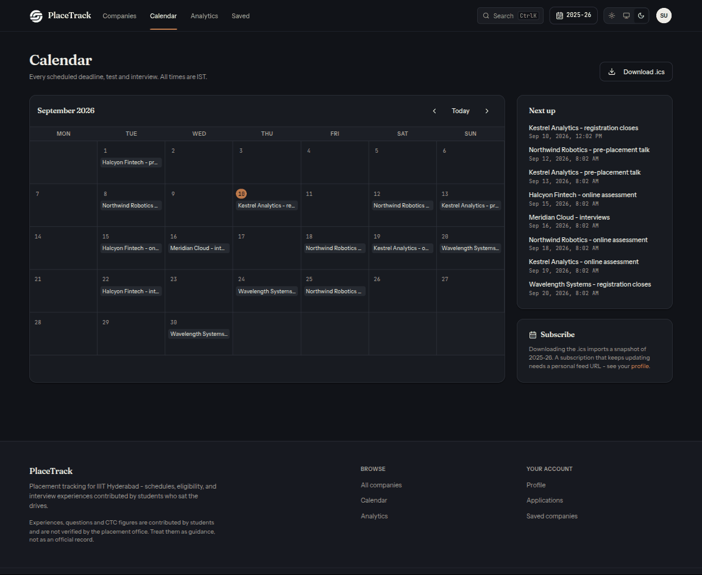
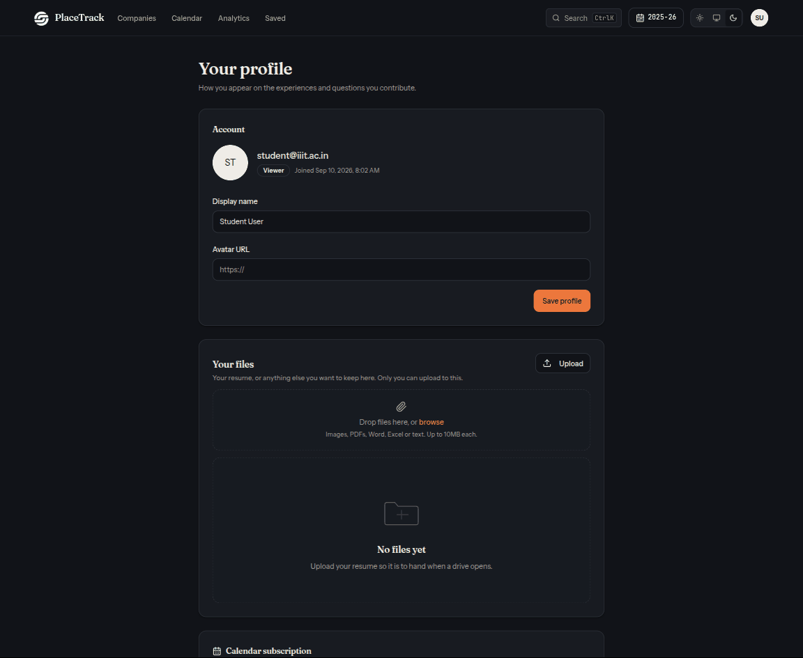
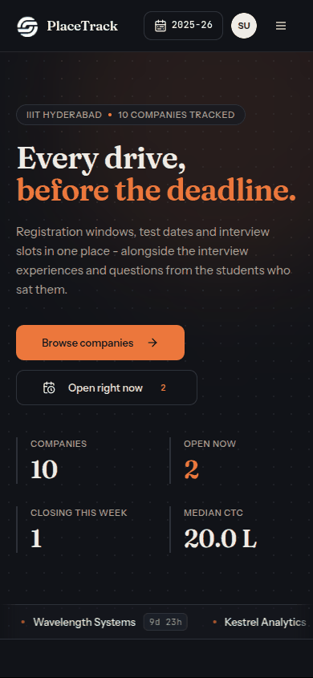
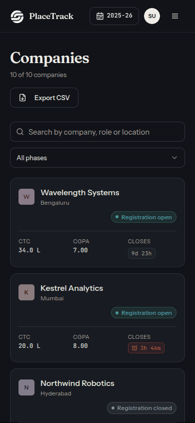
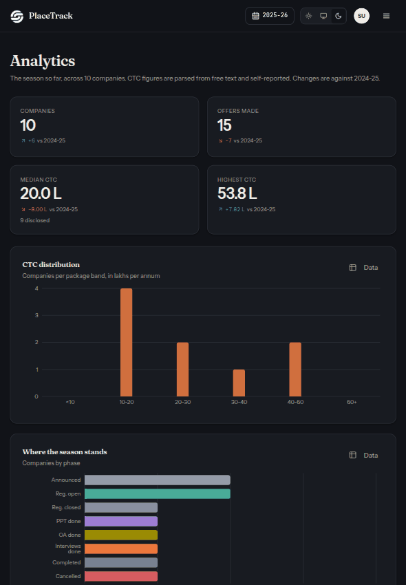

<div align="center">

<picture>
  <source media="(prefers-color-scheme: dark)" srcset="./docs/assets/adk_dev_logo_light.png">
  
</picture>

# PlaceTrack

**Placement tracking for IIIT Hyderabad. Companies, schedules, eligibility, and the interview experiences and questions students contribute after each drive.**


<br>


<br><br>

[](https://github.com/Dileepadari/placement-navigator/actions/workflows/ci.yml)

**Live:** [placements.dileepadari.dev](https://placements.dileepadari.dev) &middot; **[Developer documentation](./DEVDOC.md)** &middot; [Screenshots](#screenshots)

<p><b>Dark mode</b> &middot; <a href="./README-light.md">View this page in light mode</a></p>

</div>

---

Built for IIIT Hyderabad students, for internal use.

## Contents

- [Why this project matters](#why-this-project-matters)
- [Where it came from](#where-it-came-from)
- [Screenshots](#screenshots)
- [Responsive layout](#responsive-layout)
- [Features](#features)
- [Stack](#stack)
- [Getting started](#getting-started)
- [Scripts](#scripts)
- [Database](#database)
- [Contributors](#contributors)
- [Contributing](#contributing)
- [License](#license)

---

## Why this project matters

Placement season runs on rumour. A registration deadline is announced in one
WhatsApp group, the CGPA cutoff in another, and what the interview was actually
like exists only in the memory of whoever sat it last year. Miss the message and
you miss the drive.

PlaceTrack puts the schedule and the eligibility in one place, and then does the
harder half: it keeps the **interview experiences and questions** from the
students who sat each drive, attached to the company they belong to, so next
year's batch reads them instead of asking around.

The design decision worth naming is that **the whole site is an archive as well
as a noticeboard**. A season selector scopes every page, so 2023-24 can be read
exactly as it stood, and a company page shows what that employer paid and how
many it took in each previous year. A noticeboard that forgets is only useful for
a fortnight.

## Where it came from

It started as a spreadsheet.

Every batch at IIIT Hyderabad ends up with one: a shared sheet where somebody
types in each company as it is announced, and everybody else adds a column. It
works for about three weeks. Then two people edit the same row, the CTC column
holds `11 LPA` next to `INR 34,05,000` next to `~26`, nobody can remember whether
a blank date means "not announced" or "nobody filled it in", and the interview
notes have moved to a Google Doc that is linked from a WhatsApp message nobody
can find.

The sheet is not the problem. The problem is that a sheet cannot answer "which
drives are open right now", cannot keep last year's version while you edit this
year's, and has no idea who wrote which line. Everything here is a consequence of
those three: a computed phase instead of a status column, seasons instead of a
new file each year, and an author on every contribution.

The messy CTC strings survived on purpose. They are in the seed data, and the
parser handles all of them, because the alternative was refusing input that a
person in a hurry would actually type.

## Screenshots

Real 1440x1180 viewport renders against a local Supabase stack with the seed data
from `supabase/seed.sql`. This page shows **dark mode**; the same gallery in
light mode is at **[README-light.md](./README-light.md)**.

<table>
  <tr>
    <td width="33%" valign="top">
      
      <p align="center"><b>Home</b><br><sub>What is open now, what closes this week, what just finished.</sub></p>
    </td>
    <td width="33%" valign="top">
      
      <p align="center"><b>Companies</b><br><sub>Every drive in one table, sortable, filterable, exportable.</sub></p>
    </td>
    <td width="33%" valign="top">
      
      <p align="center"><b>A company</b><br><sub>The write-up from someone who sat it, and the season history.</sub></p>
    </td>
  </tr>
  <tr>
    <td width="33%" valign="top">
      
      <p align="center"><b>Analytics</b><br><sub>The season in numbers, compared against the one before.</sub></p>
    </td>
    <td width="33%" valign="top">
      
      <p align="center"><b>Calendar</b><br><sub>Every deadline and slot, exportable to your own calendar.</sub></p>
    </td>
    <td width="33%" valign="top">
      
      <p align="center"><b>Profile</b><br><sub>Your name on contributions, your files, your calendar feed.</sub></p>
    </td>
  </tr>
</table>

## Responsive layout

Most of this gets read on a phone between lectures. Each of these is a single
render at that exact viewport, not a scaled-down desktop shot.

<table>
  <tr>
    <td width="28%" valign="top">
      
      <p align="center"><b>Phone, 390x844</b><br><sub>The season summary stacks; the ticker keeps scrolling.</sub></p>
    </td>
    <td width="28%" valign="top">
      
      <p align="center"><b>Phone, companies</b><br><sub>The table becomes cards rather than scrolling sideways.</sub></p>
    </td>
    <td width="44%" valign="top">
      
      <p align="center"><b>Tablet, 820x1180</b><br><sub>Stat tiles go two-up; every chart keeps its axis labels.</sub></p>
    </td>
  </tr>
</table>

## Features

| | |
|---|---|
| [Seasons](#seasons) | Every page scoped to a placement year; past years stay readable |
| [Company list](#company-list) | Deadlines, cutoffs, CTC, roles, selections, with filters and sorting |
| [Company page](#company-page) | One drive in full, plus that employer's previous years |
| [Interview experiences](#interview-experiences) | Round-by-round writeups from students who sat the drive |
| [Question bank](#question-bank) | Questions per company, tagged by topic and round |
| [Discussion and voting](#discussion-and-voting) | Comments and votes on companies and contributions |
| [Documents](#documents) | JDs, offer letters, OA papers, resumes |
| [Bookmarks and applications](#bookmarks-and-applications) | Save a drive, track your own stage through it |
| [Calendar feed](#calendar-feed) | Every deadline as a subscribable `.ics` |
| [Analytics](#analytics) | CTC distribution, offers per season, phase breakdown |
| [Command palette](#command-palette) | Jump to any company or page from the keyboard |
| [CSV import and export](#csv-import-and-export) | Bulk-load a season, take the data with you |
| [Admin surface](#admin-surface) | Users, roles, seasons, moderation, announcements, audit |
| [Access](#access) | Internal to IIIT Hyderabad: nothing is public, and an admin approves every account |
| [Roles](#roles) | `viewer`, `editor`, `admin`, enforced by the API |

---

### Seasons

The whole site is an archive as well as a noticeboard. The year selector in the
header scopes every page at once, and the choice lands in the URL as `?season=`,
so a link to a past year opens on that year for whoever you send it to.

**Using it:** pick a year from the header. A banner appears when you are reading
anything other than the current season, so you never mistake an archived drive
for a live one. Seasons run August to July.

### Company list

The drive calendar: registration deadlines, PPT / OA / interview slots, CGPA
cutoffs, CTC breakdowns, roles, bond terms, and how many people were selected.

The phase shown against each company is **computed from its dates**, not stored.
A drive whose registration closed an hour ago says so without anyone updating a
field, which is the difference between a board people trust and one they stop
reading.

**Using it:** search by name, filter by phase or role, sort by any column.
Imminent deadlines are called out in the ticker at the top of the home page.

### Company page

One drive in full, plus a history strip showing what that employer paid and how
many they took in each previous season. Below the details sit the experiences,
questions, documents and discussion for that drive.

**Using it:** open any company from the list. If you sat this drive, "Add
experience" and "Add question" are on this page, and everything you write stays
editable from here afterwards, and collected under **Your contributions** in the
account menu.

### Interview experiences

Round-by-round writeups from the students who actually sat the drive, with
difficulty, outcome and advice. This is the part a spreadsheet cannot hold and
the part next year's batch actually needs.

**Using it:** write one from the company page after your process ends. You can
edit or delete your own at any time; an editor or admin can moderate. Your own
contributions are collected under **Your contributions** in the account menu.

### Question bank

Questions asked in each company's rounds, tagged by topic and by round type
(DSA, system design, behavioural, HR, puzzle), with an optional answer.

**Using it:** add them from the company page while you still remember them.
Filter by topic when preparing for a specific drive.

### Discussion and voting

Comments on companies and on individual contributions, with a vote per person on
each. Useful for the questions a writeup does not answer, and for surfacing the
experience worth reading first when a company has fifteen.

Upvote only, deliberately. A downvote on someone's account of a rejection reads
as a judgement on the person rather than on the writeup, so the signal here is
"this helped" and the absence of it.

**Using it:** comment from the company page. One vote per person per item;
clicking again takes it back.

### Documents

JDs, offer letters, OA question papers, feedback forms and your own resume.
Metadata lives in Postgres, the bytes on a self-hosted CDN
(see [DEVDOC.md](./DEVDOC.md#file-storage)).

**Using it:** the upload control sits on the company page for drive documents and
on your profile for your resume. Only a moderator can attach a document to a
company, because a company document reads as official; you can always attach to
your own writeup.

### Bookmarks and applications

Two separate things on purpose. A **bookmark** is "keep an eye on this". An
**application** is "I am in this process", and carries a stage: interested,
applied, shortlisted, OA, interviewing, offered, rejected, withdrawn, accepted.

**Using it:** the bookmark and track controls are on every company row and on the
company page. **Saved** in the header, and **Applications** in the account menu,
collect them.

### Calendar feed

Every deadline, PPT, OA and interview slot for the current season as an `.ics`
feed you subscribe to once, in a personal token URL that keeps updating.

**Using it:** the calendar subscription card on your profile gives you the URL,
and a rotate button that invalidates the old one. Paste it into
Google Calendar's "From URL", or Apple Calendar's "New Calendar Subscription".
Deadlines arrive as instants rather than hour-long meetings, so they do not block
out your day.

### Analytics

CTC distribution across the season, offers over time, phase breakdown, and the
companies taking the most people. Charts read the theme tokens, so they are
legible in both modes rather than being a light-mode image on a dark page.

**Using it:** **Analytics** in the header, or the command palette. Everything respects the selected
season, so it doubles as a year-on-year comparison.

### Command palette

**Ctrl/Cmd + K** from anywhere. Jumps to any company by name, or to any page.

### CSV import and export

Export any filtered view to CSV. Import a whole season from one, with a
downloadable template that carries exactly the accepted columns.

**Using it:** the export button sits above the company table. Import is under
**Admin**, and is idempotent: re-importing the same file updates rather than
duplicating. Derived columns (the computed phase) are exported but rejected on
import, since importing one would write a computed value back over its source.

### Admin surface

Users and roles, access approval, season management, comment moderation, the
announcement banner, signup domain rules, and an append-only audit log of who
changed what.

**Using it:** **Admin** in the header, visible to admins.

### Access

PlaceTrack is an internal portal for IIIT Hyderabad students, and what is in it
is private to the institute. No page is public. Signing up creates an account
that can see nothing: an admin has to grant it access first, and until then
every page leads to a notice saying so.

**Using it:** as a student, sign up and ask a placement admin to approve your
address. As an admin, **Admin**, then **Users**, turn on **Waiting only** for the
approval queue, and flip the **Access** switch. Switching it back off takes
effect on that person's very next request.

### Roles

`viewer` reads and contributes their own work. `editor` maintains company data
and moderates. `admin` additionally manages users and settings.

Enforced by the API on every request. The UI hides what you cannot use, but that
is a convenience, not the boundary: the edge function re-checks each one, which
is what `tests/api` exists to prove.

## Stack

| | |
|---|---|
| Frontend | React 18, TypeScript, Vite, React Router 6 |
| UI | Tailwind CSS, shadcn/ui, Radix primitives |
| Data | Supabase Postgres behind a Deno edge function, TanStack Query |
| Auth | Accounts in Postgres, bcrypt via pgcrypto, HS256 tokens the API issues itself |
| Forms | react-hook-form + zod |
| File storage | Self-hosted CDN at `mystorage.dileepadari.dev` via a Supabase Edge Function |
| Hosting | Vercel |

## Getting started

Requires Node 22+.

```sh
git clone git@github.com:Dileepadari/placement-navigator.git
cd placement-navigator
npm install
cp .env.example .env    # then fill it in - see below
npm run dev             # http://localhost:8080
```

### Environment

`.env` needs three browser-side values to run the app:

```sh
VITE_SUPABASE_PROJECT_ID="..."
VITE_SUPABASE_URL="https://<ref>.supabase.co"
VITE_SUPABASE_ANON_KEY="..."
```

The anon key is public by design: it ships in the JS bundle, and all it does is
satisfy the `apikey` header the Supabase gateway wants in front of the edge
function. It reaches no data on its own. Three further values
(`SUPABASE_ACCESS_TOKEN`, `SUPABASE_DB_PASSWORD`, `SUPABASE_SERVICE_ROLE_KEY`)
are only needed to run migrations or deploy edge functions; they have no `VITE_`
prefix, so they are never bundled. [DEVDOC.md](./DEVDOC.md#environment) says where
each one comes from.

## Scripts

| Script | Does |
|---|---|
| `npm run dev` | Dev server on :8080 |
| `npm run build` | Production build |
| `npm run lint` | ESLint |
| `npm run typecheck` | `tsc --noEmit` |
| `npm test` | Unit and component tests |
| `npm run db:push` | Apply migrations to the linked project |
| `npm run fn:deploy` | Deploy the `placements` edge function |

## Database

Migrations live in `supabase/migrations/` and are applied in filename order.
`supabase/backups/` holds dumps taken before schema changes. It is gitignored:
those files contain real emails and password hashes.

```sh
npm run db:push      # apply to the linked project
```

There are no generated database types. The browser never talks to PostgREST -
every request goes through the `placements` edge function - so the types that
matter are the hand-written API shapes in `src/types/database.ts` and
`src/lib/api.ts`. Change a column and you change those by hand, deliberately.
See [supabase/README.md](./supabase/README.md) for how to add a migration safely.

## Contributors

<table>
  <tr>
    <td align="center">
      <a href="https://github.com/Dileepadari">
        
        <br><sub><b>Dileep Adari</b></sub>
      </a>
      <br><sub>Author and maintainer</sub>
    </td>
    <td align="center">
      <a href="https://github.com/Delhiproject0">
        
        <br><sub><b>Delhiproject0</b></sub>
      </a>
      <br><sub>Upstream repository owner</sub>
    </td>
  </tr>
</table>

The experiences, questions and CTC figures on the live site are contributed by
IIIT Hyderabad students. They are not verified by the placement office.

## Contributing

Branch off `main`, open a PR. See [CONTRIBUTING.md](./CONTRIBUTING.md).

CI runs three jobs and all must pass:

- **web** - lint, typecheck, the unit tests and the production build.
- **functions** - `deno check` over the edge function.
- **api** - starts a real Supabase stack and runs `tests/api` against it. These
  cover the authorization checks that stand in for row-level security, and they
  skip themselves locally when no stack is listening, so this job is the only
  place they are guaranteed to run.

If you change `README.md`, regenerate its light-mode twin so the pair stays in
sync:

```bash
node scripts/build-light-readme.mjs
```

## License

MIT. See [LICENSE](./LICENSE).
